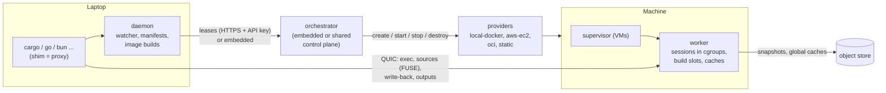

# cloudsourced

Run build and test commands on cloud machines as if they ran locally.

```console
$ cargo build          # ~/.cloudsourced/bin/cargo -> cloudsourced
   Compiling hello v0.1.0 (/home/me/hello)
    Finished `dev` profile [unoptimized + debuginfo] target(s) in 0.61s
$ ./target/debug/hello # the binary was copied back
```

`cloudsourced` is a single static Go binary. Invoked as `cargo`, `go`,
`bun`, `npm`, ... through a shim (or as `cloudsourced run <tool> ...`), it
decides whether the command runs locally or on a build machine and then
behaves exactly like the local process: output, terminal, stdin, signals and
exit code. Sources are projected onto the machine at the same absolute path,
build directories stay warm on the machine for up to 24 hours, outputs come
back on demand, and when no machine is available the command runs locally.

## Architecture



| Component | Runs on | Does |
|---|---|---|
| proxy | laptop | Invoked through a shim or `cloudsourced run`. The tool adapter splits the command into phases (local or remote); the proxy runs the remote session and copies outputs back. |
| daemon | laptop | Watches sources, keeps versioned manifests, builds environment images, talks to machines, and runs the embedded orchestrator unless a control plane is configured. |
| orchestrator | laptop (embedded) or control plane | Places sessions, scales the pool, stops idle machines, destroys expired ones. |
| worker | machine | Projects the sources over FUSE at the same path, runs sessions in their own mount namespace and cgroup, keeps build slots and caches, writes changed sources back. |
| supervisor | VM and static machines | Starts the machine container layout, receives the machine secrets, enforces idle stop and the lifetime. |

## Quick start (local Docker, no cloud account)

Requirements: Linux, Docker, `/dev/fuse`, Go 1.26.

```sh
make build                                     # static binary in bin/cloudsourced
bin/cloudsourced shim install cargo
export PATH="$HOME/.cloudsourced/bin:$PATH"    # in ~/.profile or ~/.zshrc
bin/cloudsourced shim status                   # checks that the shims are first in PATH

cd ~/src/my-crate
cloudsourced init --write                      # writes .cloudsourced.toml
cloudsourced doctor                            # checks installation and configuration
cargo build                                    # runs on a local-docker machine
cloudsourced why                               # where and why it ran
```

Without any client configuration the daemon embeds the orchestrator and
uses one local-docker provider (machines are Docker containers on this
host; set `CLOUDSOURCED_DOCKER="sudo -n docker"` if your user cannot talk to
Docker). For cloud machines follow the [AWS](docs/guides/aws.md) or
[OCI](docs/guides/oci.md) guide; for a team, run a
[shared control plane](docs/control-plane.md).

## Documentation

Reference:

* [Configuration](docs/configuration.md): client, pool and repository files, every key
* [CLI](docs/cli.md): all commands, flags and environment variables
* [Tools, tests and outputs](docs/tools.md): tool adapters, test split, output overlay, port forwarding, rust-analyzer
* [Caches and storage](docs/caches-and-storage.md): cache scopes, pruning, object store, snapshots, compiler cache
* [Scheduling](docs/scheduling.md): placement, scaling, overcommit, simulator
* [Control plane](docs/control-plane.md): shared orchestrator, TLS, container image, AWS deployment
* [Operations](docs/operations.md): metrics, logs, tracing, events, report, top, doctor, retention
* [Security](docs/security.md): identities, tokens, secrets, isolation
* [Compatibility](docs/compatibility.md): what works, what is limited, what stays local
* [Development](docs/development.md): tests, end-to-end tests, benchmarks

Guides:

* Providers: [AWS EC2](docs/guides/aws.md), [Oracle Cloud](docs/guides/oci.md)
* Ecosystems: [Rust](docs/guides/rust.md), [TypeScript / Node](docs/guides/typescript.md), [Go](docs/guides/go.md)

Project: [roadmap](docs/ROADMAP.md), [design plan](docs/PLAN.md) (German).
